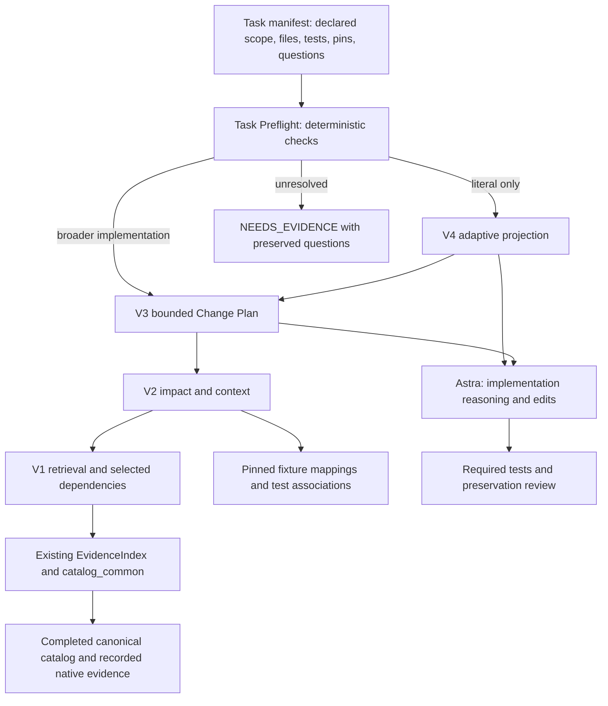

# Current architecture and recorded design decisions

## Data flow

The diagram shows dependency/validation flow, not an external service. All layers
are local Python. V4 always constructs and validates V3 before projection;
preflight chooses which existing planner to invoke. None of these layers calls a
model, modifies research or executes gameplay.

| Component | Responsibility | Boundary |
| --- | --- | --- |
| `mod_intelligence.py` | CLI/protocol, catalog lookup, source verification, numeric integrity, selected dependency resolution, impact/context | No JAR extraction, no inferred mechanic relationship by similar names |
| `audit_catalog_integrity.py`, `catalog_common.py` | Existing evidence index, schema-aware witness/source validation, canonical paths | Native/Vanilla/reference evidence formats remain distinct |
| `mod_intelligence_links.json` | Exact pinned file/symbol associations and historical validation references | Static fixtures; NOT_RUN and association-only coverage |
| `mod_intelligence_plan.py` | Normalize explicit numeric requests; assemble connected facts, constraints, locations and validation obligations | No code generation, natural-language value selection or complete-impact proof |
| `mod_intelligence_adaptive.py`, `mod_intelligence_scope_profiles.json` | Three pinned literal profiles; structural partition and restoration references | No global minimum-context proof or runtime independence claim |
| `task_preflight.py` | Strict task manifest; root-confined baseline files/hashes; source checks; scope route; complete plan envelope | Declared scope/approval, one native and optional one dependency identity; no tests executed |
| `examples/sugar_rush_workflow.py`, `animation_clock_preview.py` | Bounded executable consumers of CLI contracts | Static diagnostic fixtures, not production integration |
| Test modules | Integrity, protocol, mappings, plan/projection and fixture regressions | Passing tests do not establish Minecraft correctness |

The canonical catalog is the authority for verified current mechanics. Caller
requests describe proposed changes. A plan's `REQUIRES_REVIEW` statements are not
new verified facts. Source pins compare catalog expectations; local artifact
hashing is optional and explicitly distinguished from a recorded pin match.

## Decision register

This register consolidates decisions recorded in version docs, commits, reports
and the available task conversation. It does not claim to recover undocumented
private reasoning. Source details are linked through the history/experiment index.

| Decision | Reason / evidence | Disposition |
| --- | --- | --- |
| Separate tooling branch from completed research | Original authorization after Alex's Mobs closure; research STOP remains | Retained; no new research/production work |
| Reuse catalog/resolver infrastructure | Existing pinned evidence already answers mechanics; rescanning repeats completed work | V1 onward |
| Compact JSON with explicit error codes | Coding consumers need machine-readable success/failure, not partial unverified output | Retained through preflight |
| Verify witnesses even when output sections omit evidence | Output reduction must not weaken integrity | Retained |
| Validate numeric literal sites, not invocation operands | Astra nested-binding audit reproduced contradictory returned values | Repaired and regression-tested |
| Explicit runtime checks instead of Python assertions | `-O` bypassed integrity validation | Repaired in shared relevant validation |
| Schema-aware source identities | Native JAR pins mandatory; legitimate Vanilla/selected-reference formats differ | Repaired without rejecting valid formats |
| Keep nonfinite JVM operands opaque, reject nonfinite contract numbers | Historical bytecode representation differs from JSON numeric promises | Narrow exception, not a validation bypass |
| Preserve legitimate item attribute binding variants | Initial strict repair needed compatible native argument roles/sites | Corrected in `a314516` |
| Add a narrow obligation selector | Sugar Rush needed one contract, whole-mod output was coarse and unresolved | V1.5, using exact canonical links |
| Keep missing hashes and file-only references explicit | Recorded evidence cannot supply absent proof | UNKNOWN/gap metadata retained |
| Keep formula translation in bounded consumers | Static numeric/prose contracts do not imply a universal evaluator | No formula framework added |
| Bounded impact categories and pinned fixture targets | Useful coding navigation without asserting complete dependency graphs | V2 and target prototype |
| Treat peer links as conditional, tests as associations | Shared methods/strings do not prove required edits or future test coverage | Retained in V2–V4 |
| Explicit numeric request selectors | Prose-only boost requests are ambiguous; guessing would invent policy | V3 rejects/defers unresolved selection |
| Preserve all required content or fail budget | Truncation can omit gates and evidence | CLI byte budgets return errors, not partial success |
| Structural, pinned adaptive profiles | Name-based relevance can falsely discard behavioral fields | Three V4 profiles only |
| EXCLUDE does not mean runtime independence | Literal footprint is narrower than broader API/behavior work | Scope warning and restoration retained |
| Full upstream validation before projection | Compression must not weaken source/dependency checks | V4 backend reads intentionally unchanged |
| Retain failures and restart setup-contaminated runs | Missing validation document invalidated first six-agent setup | 58 discarded operations archived; fresh contexts used |
| Compare model capability with the same V4 arms | Mixing V3 and V4 would confound workflow/model effects | Astra/Sol comparison uses prior successful B arms |
| Use Medium for the measured tasks | Extra High had equal frozen quality and ~2.08× summed time | Bounded recommendation, not universal complexity routing |
| Do not adopt constrained prompting as default | No activity reduction; arithmetic error-handling regression | Negative/inconclusive result preserved |
| Prefer explicit task scope to a new retrieval engine/router | Two tasks repeatedly reconciled broader specs with literal-only plans | Small deterministic preflight experiment |
| Keep preflight outside V4 internals | User required no redesign, model router, removed validation or new intelligence version | Standalone wrapper only |
| Preserve complete selected plan beside compact brief | Concision cannot silently remove UNKNOWNs or preservation obligations | Preflight output budget errors remain explicit |
| Do not optimize during fresh preflight A/B | Changing tools/tests between arms would invalidate comparison | Wrapper and V4 hashes unchanged |
| Count operational retries honestly | B repeated truncated preflight; A repeated asynchronous test | No post-hoc removal of costs from metrics |
| Do not claim usage savings from bytes or wall time | Token/allowance/billing telemetry unavailable | All efficiency conclusions remain qualified |
| Archive rather than reopen milestones | User requested complete history; no new version or research authorization | Preserve current implementation and raw evidence |

## What still requires a developer or model

Actual source correspondence outside mapped fixtures, desired policy, API design,
formula interpretation, task-specific boundary cases, complete test coverage and
runtime validation remain manual. Preflight cannot prove a `literal_only`
declaration is truthful. It checks that listed files/tests exist and match pins,
not that the list is complete or commands provide coverage. New target files and
multiple expected dependency artifacts are outside this bounded wrapper.

The repeated scope-selection problem is observable in tool traces. The amount
of internal model reasoning it costs is not observable in the available records.
The architecture should not be described as a measured reasoning optimizer.
